# Acceso a Datos · RA2 · Pablo Gamero Ávila

## Ficha del alumno/a

| Campo | Dato |
| :--- | :--- |
| **Nombre y apellidos** | Pablo Gamero Ávila |
| **Centro educativo** | IES Antonio Gala |
| **Empresa** | Iprevencion |
| **Temática elegida para tu proyecto** | Gestión Académica de 2º de DAM (`modulos` y `alumnos`) |
| **URL de tu repositorio (GitHub / GitLab)** | `https://github.com/Pablogameroavila/Acceso-a-datos_RA2.git` |
| **Gestor elegido y versión del driver** | MariaDB Server 12.3 (LTS) · Driver `mariadb-java-client 3.5.10` |

**Entorno:** JDK 21 · IntelliJ IDEA · MariaDB Server (Docker) · `mariadb-java-client 3.5.10`

---

## Cómo ejecutar el proyecto

1. Levantar el contenedor de MariaDB (`docker start mariadb-ra2`) con la base de datos `dam2` y el usuario limitado `dam2_app`.
2. Copiar [`config.properties.example`](config.properties.example) a `config.properties` en la raíz del proyecto e introducir la contraseña de `dam2_app` (el fichero `config.properties` está excluido en `.gitignore`).
3. Abrir el proyecto en IntelliJ IDEA con **JDK 21** verificando que `lib/mariadb-java-client-3.5.10.jar` está vinculado en *Project Structure → Modules → Dependencies*.
4. Ejecutar `app.Main` con el *Working directory* apuntando a la raíz del proyecto y seleccionar las opciones `1` a `8` del menú interactivo.

---

## a) Valoración de conectores (criterio a)

### 1. ¿Qué es un conector (driver) JDBC y qué capa técnica asume?
Un conector o *driver* JDBC es una librería externa (normalmente empaquetada en un fichero `.jar`) suministrada por el fabricante del gestor de bases de datos o por la comunidad, cuya función es implementar las interfaces estándar de la API `java.sql` (`Driver`, `Connection`, `PreparedStatement`, `ResultSet`). Actúa como **capa intermedia de traducción** entre nuestra aplicación Java y el Sistema Gestor de Bases de Datos (SGBD): nuestro código invoca únicamente métodos estándar de JDBC y el driver se encarga de convertir esas llamadas al protocolo binario o de red nativo del motor correspondiente, devolviendo los resultados nuevamente como objetos Java.

### 2. Tabla comparativa: `sqlite-jdbc` frente a `mariadb-java-client`

| Criterio de comparación | `sqlite-jdbc` (SQLite) | `mariadb-java-client` (MariaDB) |
| :--- | :--- | :--- |
| **Arquitectura de red** | **Embebido (local):** no hay red ni servidor; el motor se ejecuta dentro del mismo proceso de la JVM leyendo un fichero `.db`. | **Cliente-servidor (TCP/IP):** la aplicación Java actúa como cliente que se conecta por red (puerto `3306` por defecto) a un servicio independiente. |
| **Instalación y configuración** | **Cero instalación:** el propio `.jar` incluye las librerías nativas del motor SQLite; basta con añadirlo al *classpath* e indicar la ruta del fichero. | **Requiere servidor:** hay que instalar/levantar MariaDB Server (o un contenedor Docker), crear la base de datos y configurar usuarios y permisos. |
| **Ventaja principal** | Portabilidad absoluta y despliegue inmediato en un único archivo local sin dependencias de infraestructura. | Alta concurrencia multiusuario, seguridad basada en usuarios/permisos granulares y soporte completo de características empresariales. |
| **Desventaja principal** | Concurrencia de escritura muy limitada (bloqueo a nivel de fichero) y ausencia total de control de usuarios o permisos. | Mayor complejidad de despliegue, mantenimiento del servicio y necesidad de gestionar credenciales de acceso de forma segura. |
| **Tipo de driver (clasificación JDBC)** | **Híbrido autocontenido (nativo embebido):** empaqueta librerías nativas en C de SQLite que el propio `.jar` extrae y carga en tiempo de ejecución. | **Tipo 4 (Protocolo nativo en Java puro):** traduce directamente las llamadas JDBC al protocolo de red de MariaDB sin librerías nativas intermedias. |
| **Soporte de procedimientos almacenados** | **No soportado:** SQLite carece de lenguaje procedural en el servidor (`CallableStatement` no es aplicable). | **Soportado:** permite definir procedimientos y funciones (`IN` / `OUT`) en el servidor e invocarlos desde Java mediante `CallableStatement`. |

### 3. Ventajas e inconvenientes aplicados a mi temática (Gestión de 2º de DAM)

**Ventajas:**
1. **Cambio sencillo entre entorno de aula/pruebas y secretaría:** Gracias a que la lógica de `ModuloDAO` y `AlumnoDAO` solo depende de `java.sql`, podemos desarrollar y probar la aplicación en local con SQLite (`dam2.db`) y migrarla a un servidor MariaDB del instituto modificando únicamente `config.properties` y el `.jar` del conector, sin reescribir la capa de acceso a datos.
2. **Aislamiento del protocolo de comunicación:** Al gestionar las matrículas y calificaciones de los alumnos de 2º de DAM no necesitamos conocer cómo codifica MariaDB sus paquetes TCP ni cómo gestiona SQLite los bloques en disco; `PreparedStatement` y `ResultSet` abstraen todo ese bajo nivel.
3. **Actualizaciones de seguridad y rendimiento sin tocar el código:** Si se descubre una vulnerabilidad o mejora de rendimiento en la comunicación con la base de datos del centro, basta con sustituir el `.jar` de `sqlite-jdbc` o `mariadb-java-client` por una versión parcheada manteniendo intacto nuestro código Java.

**Inconvenientes:**
1. **Diferencias de dialecto SQL entre gestores:** Aunque usamos JDBC estándar, al definir las tablas `modulos` y `alumnos` el script DDL no es 100 % portable: SQLite exige `INTEGER PRIMARY KEY AUTOINCREMENT` y activar `PRAGMA foreign_keys = ON` en cada conexión, mientras que MariaDB usa `INT AUTO_INCREMENT PRIMARY KEY` y `ENGINE = InnoDB`.
2. **Persistencia del desfase objeto-relacional:** El conector nos entrega filas en un `ResultSet`, pero seguimos teniendo que programar manualmente el mapeo columna a columna hacia los atributos de nuestras clases modelo (`Alumno` y `Modulo`) y gestionar a mano los valores `NULL` en campos opcionales como `observaciones`.
3. **Gestión de compatibilidad de dependencias:** Es necesario vigilar que la versión del `.jar` del conector sea compatible con nuestro JDK (Java 21) y con la versión instalada de MariaDB Server, además de incluir librerías auxiliares como `slf4j-api` en el caso de `sqlite-jdbc`.

---

## b) Gestores embebido e independiente (criterio b)

Se ha probado un gestor embebido (**SQLite**) y un gestor independiente cliente-servidor (**MariaDB** en Docker) mediante cliente de línea de comandos (`sqlite3` y cliente `mariadb`), creando en ambos la tabla `modulos` de **2º de DAM** con registros de prueba y verificando las versiones de cada motor:

* **SQLite (`dam2.db`):** 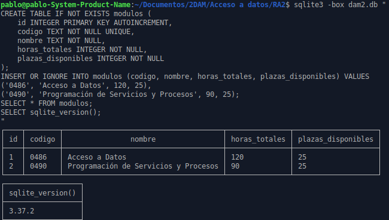
* **MariaDB (usuario no administrador `dam2_app`):** 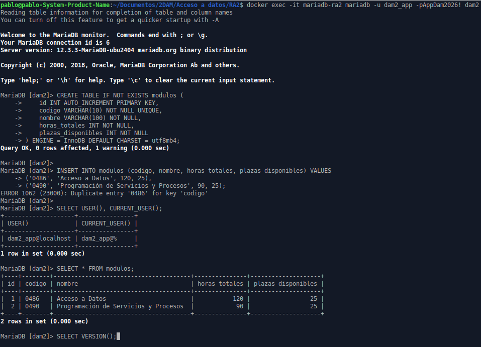

### Diferencias observadas entre ambos gestores
Al trabajar con ambos motores en la práctica destacan tres diferencias claras:
1. **Despliegue e infraestructura:** SQLite no requiere instalar ni arrancar ningún servicio; al ejecutar `sqlite3 dam2.db` se genera directamente el fichero local. En cambio, MariaDB exige levantar un proceso servidor independiente escuchando en el puerto TCP `3306`.
2. **Seguridad y control de acceso:** En SQLite no existen usuarios ni permisos (cualquiera con acceso de lectura/escritura al archivo `.db` tiene control total), mientras que en MariaDB se ha creado la base de datos `dam2` y un usuario específico con privilegios limitados (`dam2_app`) para no operar nunca como `root`.
3. **Dialecto SQL:** Aunque el `INSERT` y el `SELECT` son idénticos, la definición de la clave primaria autoincremental y los tipos cambian (`INTEGER PRIMARY KEY AUTOINCREMENT` y `TEXT` en SQLite frente a `INT AUTO_INCREMENT PRIMARY KEY`, `VARCHAR(n)` y `ENGINE = InnoDB` en MariaDB).

---

## c) Conector idóneo (criterio c)

Para el desarrollo de la aplicación de **Gestión Académica de 2º de DAM** se ha elegido el gestor cliente-servidor **MariaDB** mediante su conector oficial **`mariadb-java-client` versión `3.5.10`**, descargado desde el repositorio oficial de **Maven Central** (`repo1.maven.org/maven2/org/mariadb/jdbc/mariadb-java-client`).

### Justificación técnica de la elección
Para gestionar los módulos y las calificaciones de los alumnos de **2º de DAM**, **`mariadb-java-client 3.5.10`** es el conector idóneo porque es un **driver de tipo 4 (Java puro)** que se comunica directamente con el protocolo de red de MariaDB Server sin librerías nativas intermedias, permitiendo que varios profesores o puestos de secretaría accedan de forma concurrente mediante usuarios con permisos restringidos (`dam2_app`) y ofreciendo soporte completo para transacciones InnoDB y procedimientos almacenados.

* **Conector vinculado en IntelliJ IDEA (`lib/mariadb-java-client-3.5.10.jar`):** 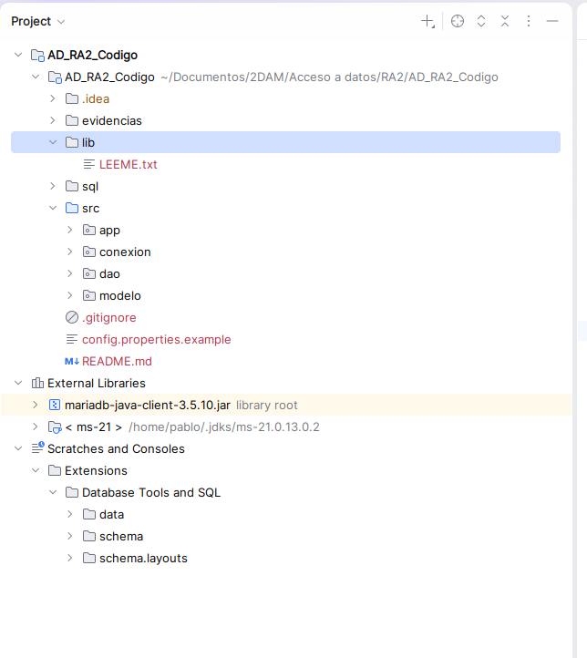

---

## d) Establecer la conexión (criterio d)

La gestión de conexiones se ha centralizado en [`ConexionBD.java`](src/conexion/ConexionBD.java). Para proteger las credenciales en un repositorio público:
* La URL (`jdbc:mariadb://localhost:3306/dam2`), el usuario restringido (`dam2_app`) y la contraseña se cargan externamente desde `config.properties` (o mediante la variable de entorno `AD_DB_PASSWORD`).
* El fichero `config.properties` está excluido en `.gitignore`, subiendo al repositorio únicamente la plantilla sin credenciales [`config.properties.example`](config.properties.example).
* Ante un fallo de conexión, el bloque `catch (SQLException e)` imprime únicamente el `ErrorCode` y el `SQLState` sin exponer datos sensibles, y relanza la excepción para que la capa superior decida cómo actuar.

### Evidencias
* **Conexión establecida con metadatos de MariaDB y del driver:** 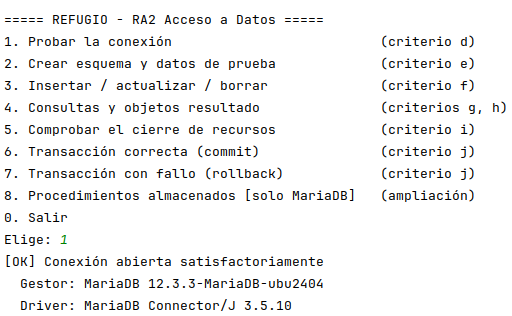
* **Fallo controlado con mensaje seguro (sin credenciales o de puerto):** 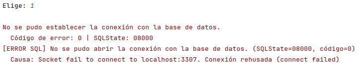

---

## e) Estructura de la base de datos (criterio e)

Se ha diseñado un modelo relacional **1:N** en [`sql/esquema_mariadb.sql`](sql/esquema_mariadb.sql) (junto con los datos de prueba en [`sql/datos_iniciales.sql`](sql/datos_iniciales.sql)) adaptado a la **Gestión Académica de 2º de DAM**, ejecutado directamente desde Java mediante [`EjecutorScript.java`](src/conexion/EjecutorScript.java):

* **Tabla padre `modulos`:** almacena los módulos profesionales del curso (`id` PK autoincremental, `codigo` `VARCHAR(10) UNIQUE NOT NULL`, `nombre` `VARCHAR(100) NOT NULL`, `horas_totales` `INT` con restricción `CHECK > 0` y `plazas_disponibles` `INT` con restricción `CHECK >= 0`).
* **Tabla hija `alumnos`:** almacena las matrículas y calificaciones (`id` PK autoincremental, `nombre` `VARCHAR(80) NOT NULL`, `nota_media` `DECIMAL(4,2) DEFAULT 5.00` con `CHECK` entre `0.00` y `10.00`, `estado` `VARCHAR(20) DEFAULT 'MATRICULADO'` con `CHECK` de valores permitidos, `fecha_matricula` `DATE NOT NULL`, `observaciones` `VARCHAR(200)` opcional y `id_modulo` como clave foránea `FOREIGN KEY` referenciando a `modulos(id)` con `ON UPDATE CASCADE` y `ON DELETE RESTRICT`).
* **Justificación de la relación 1:N:** un módulo profesional de 2º de DAM tiene muchos alumnos matriculados, mientras que cada registro de matrícula de un alumno pertenece a un único módulo.

### Evidencias
* **Estructura de tablas, tipos y clave foránea en MariaDB:** 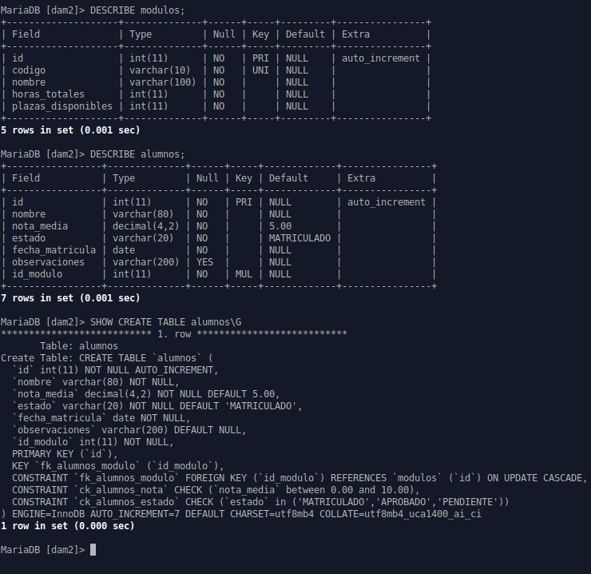
* **Ejecución del script desde Java y verificación de integridad referencial (`ErrorCode 1452`):** 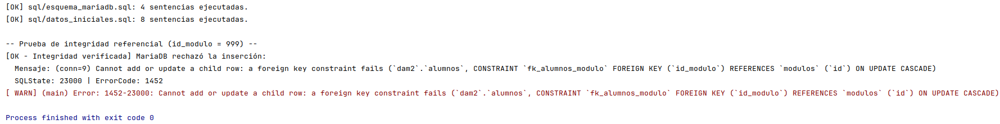

---

## f) Modificación de datos (criterio f)

En [`AlumnoDAO.java`](src/dao/AlumnoDAO.java) y [`ModuloDAO.java`](src/dao/ModuloDAO.java) se han implementado las operaciones de escritura empleando exclusivamente **`PreparedStatement` con parámetros (`?`)** para evitar cualquier riesgo de inyección SQL:

```java
// Ejemplo de INSERT recuperando la clave primaria autoincremental
String sql = "INSERT INTO alumnos (nombre, nota_media, estado, fecha_matricula, observaciones, id_modulo) VALUES (?, ?, ?, ?, ?, ?)";
try (Connection con = ConexionBD.conectar();
     PreparedStatement ps = con.prepareStatement(sql, Statement.RETURN_GENERATED_KEYS)) {
    ps.setString(1, a.getNombre());
    ps.setBigDecimal(2, a.getNotaMedia());
    ps.setString(3, a.getEstado());
    ps.setObject(4, a.getFechaMatricula());
    ps.setNull(5, Types.VARCHAR);
    ps.setInt(6, a.getIdModulo());
    int filas = ps.executeUpdate();
}
```

### Evidencias antes y después en MariaDB
* **INSERT:** 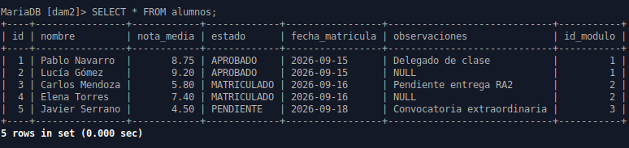 · 
* **UPDATE:** 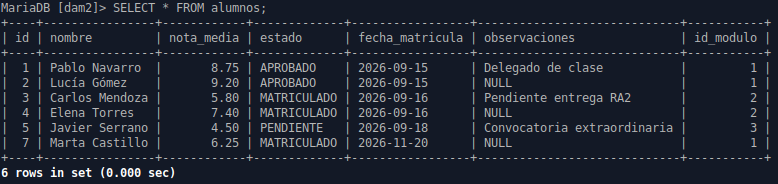 · 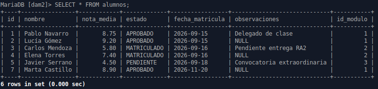
* **DELETE:**  · 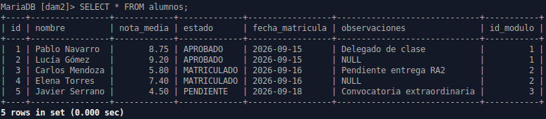

---

## g) Objetos para almacenar los resultados (criterio g)

Para resolver el desfase objeto-relacional se han definido las clases modelo [`Modulo.java`](src/modelo/Modulo.java) y [`Alumno.java`](src/modelo/Alumno.java) (con tipos variados `int`, `String`, `BigDecimal` y `LocalDate`, constructores vacío y completo, getters/setters y `toString()`). La conversión de cada fila del `ResultSet` se centraliza en los métodos `mapear(ResultSet rs)` de cada DAO, gestionando explícitamente los valores `NULL` de la columna opcional `observaciones`.

### Tabla de correspondencia objeto-relacional

| Tabla (MariaDB) | Columna SQL | Tipo SQL | Clase Java | Atributo Java | Tipo Java | Método `ResultSet` |
| :--- | :--- | :--- | :--- | :--- | :--- | :--- |
| `modulos` | `id` (PK) | `INT` | `Modulo` | `id` | `int` | `rs.getInt("id")` |
| `modulos` | `codigo` | `VARCHAR(10)` | `Modulo` | `codigo` | `String` | `rs.getString("codigo")` |
| `modulos` | `nombre` | `VARCHAR(100)` | `Modulo` | `nombre` | `String` | `rs.getString("nombre")` |
| `modulos` | `horas_totales` | `INT` | `Modulo` | `horasTotales` | `int` | `rs.getInt("horas_totales")` |
| `modulos` | `plazas_disponibles` | `INT` | `Modulo` | `plazasDisponibles` | `int` | `rs.getInt("plazas_disponibles")` |
| `alumnos` | `id` (PK) | `INT` | `Alumno` | `id` | `int` | `rs.getInt("id")` |
| `alumnos` | `nombre` | `VARCHAR(80)` | `Alumno` | `nombre` | `String` | `rs.getString("nombre")` |
| `alumnos` | `nota_media` | `DECIMAL(4,2)` | `Alumno` | `notaMedia` | `BigDecimal` | `rs.getBigDecimal("nota_media")` |
| `alumnos` | `estado` | `VARCHAR(20)` | `Alumno` | `estado` | `String` | `rs.getString("estado")` |
| `alumnos` | `fecha_matricula` | `DATE` | `Alumno` | `fechaMatricula` | `LocalDate` | `rs.getObject("fecha_matricula", LocalDate.class)` |
| `alumnos` | `observaciones` | `VARCHAR(200)` (nullable) | `Alumno` | `observaciones` | `String` | `rs.getString("observaciones")` + `rs.wasNull()` |
| `alumnos` | `id_modulo` (FK) | `INT` | `Alumno` | `idModulo` | `int` | `rs.getInt("id_modulo")` |

---

## h) Consultas (criterio h)

En [`AlumnoDAO.java`](src/dao/AlumnoDAO.java) y [`ModuloDAO.java`](src/dao/ModuloDAO.java) se han implementado cinco tipos de consulta ejecutadas mediante `PreparedStatement` y `executeQuery()`:
1. **Consulta general (`listarTodos`):** recupera todos los registros ordenados por clave primaria devolviendo `List<Alumno>` y `List<Modulo>`.
2. **Consulta filtrada con parámetro (`listarPorEstado(String estado)`):** filtra mediante `WHERE estado = ?` pasando el parámetro de forma segura con `ps.setString(1, estado)`.
3. **Búsqueda por clave primaria (`buscarPorId(int id)`):** devuelve `Optional<Alumno>` (`Optional.empty()` cuando el identificador no existe) para evitar retornos `null`.
4. **Consulta agregada (`contarPorEstado`):** agrupa los alumnos con `SELECT estado, COUNT(*) AS total FROM alumnos GROUP BY estado`.
5. **Consulta multitabla (`listarConModulo`):** combina `alumnos` y `modulos` mediante `INNER JOIN` para mostrar cada alumno junto al código y nombre de su módulo.

### Evidencia
* **Salida en consola de todas las consultas:** 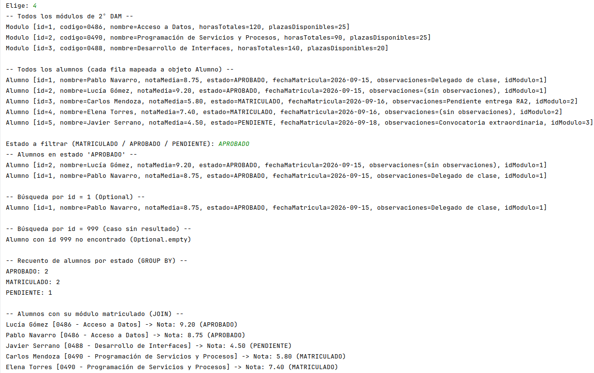

---

## i) Liberación de recursos (criterio i)

Todos los accesos a base de datos del proyecto declaran `Connection`, `PreparedStatement` y `ResultSet` dentro de bloques **`try-with-resources`**:

```java
try (Connection con = ConexionBD.conectar();
     PreparedStatement ps = con.prepareStatement(sql);
     ResultSet rs = ps.executeQuery()) {
    while (rs.next()) {
        lista.add(mapear(rs));
    }
} // Cierre automático en orden inverso: 1º rs, 2º ps, 3º con
```

### Explicación técnica
Para poder declararse en la cabecera de un `try-with-resources`, estos objetos implementan la interfaz **`java.lang.AutoCloseable`** (y su subinterfaz `java.io.Closeable`), lo que garantiza que Java invoque automáticamente su método `close()` al salir del bloque (incluso si se lanza una `SQLException`) y en **orden inverso al de apertura** (`ResultSet` $\rightarrow$ `PreparedStatement` $\rightarrow$ `Connection`). Si en un servidor de producción con **2.000 usuarios concurrentes** olvidáramos cerrar las conexiones, se agotaría inmediatamente el límite de conexiones simultáneas del SGBD (en MariaDB `max_connections` es 151 por defecto), provocando bloqueos y errores de denegación de servicio (`Too many connections`) sin poder esperar a que actúe el recolector de basura.

### Evidencia
* **Comprobación de cierre automático (`DemoRecursos`):** 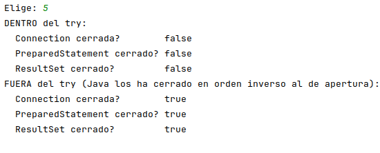

---

## j) Transacciones (criterio j)

En [`DamTransacciones.java`](src/dao/DamTransacciones.java) se ha implementado la operación compuesta `matricularAlumnoConPlaza(Alumno alumno, boolean forzarError)`, que desactiva el modo automático (`con.setAutoCommit(false)`) para ejecutar de forma atómica dos sentencias dependientes:
1. Insertar al nuevo alumno en `alumnos` recuperando su clave generada.
2. Descontar una plaza disponible en `modulos` (`plazas_disponibles = plazas_disponibles - 1`).

Si ambas operaciones tienen éxito se consolida con `con.commit()`; si ocurre cualquier fallo se ejecuta `con.rollback()` en el bloque `catch` y finalmente se restaura el `autoCommit` original en `finally`.

### Reflexión sobre la importancia del `rollback()`
El uso de `rollback()` resulta imprescindible para preservar la **atomicidad e integridad de los datos** (propiedades ACID) ante fallos intermedios de red, caídas del servidor o errores de validación. Sin `rollback()`, un fallo tras el primer `INSERT` dejaría al alumno matriculado en la base de datos sin haber descontado su plaza en el módulo correspondiente, generando una inconsistencia grave en la oferta real de plazas de 2º de DAM.

### Evidencias
* **Transacción completada con `commit()`:** 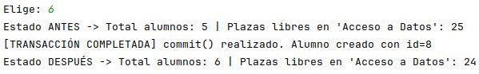
* **Transacción abortada con `rollback()` (base de datos intacta):** 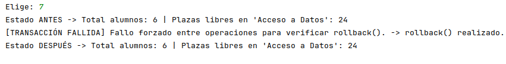